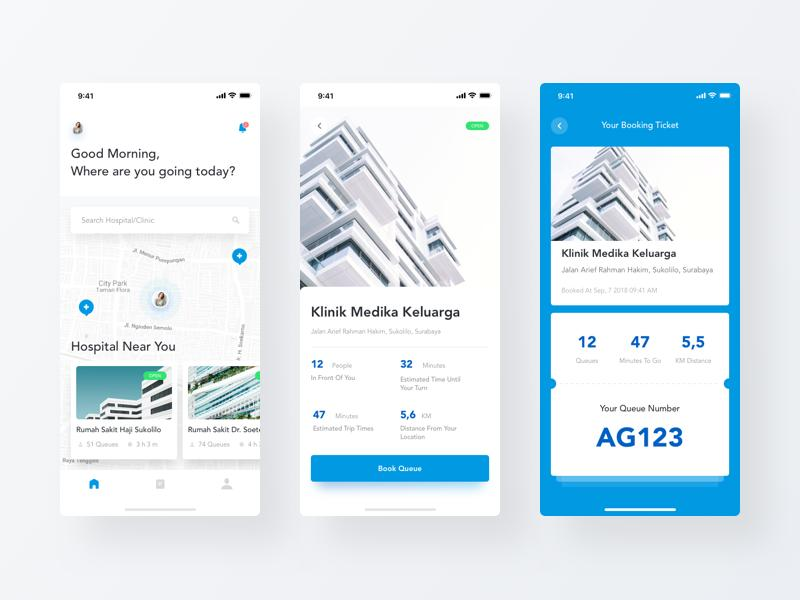

# Queueless

Skip the line, not the service. Queueless lets people join a virtual queue at a clinic,
university office, or small business from their phone, and watch their place in line live.



> Screenshots of the finished app will go here.

## Overview

Two roles, deliberately simple:

- **Customer**: no sign-up or login. Browse places, join a queue, see live position and estimated
  wait, cancel, or rejoin.
- **Staff**: sign up / log in, manage their place profile, open or close the queue, and call the
  next customer from a dashboard.

## Features

- Live queue position and estimated waiting time
- Join, cancel, and rejoin a queue
- Ticket with a queue code (e.g. `A012`) and "your turn" state
- Staff dashboard: live waiting list, call next, mark served / no-show
- Place profile management (name, category, address, image, average service time)

## Tech Stack

| Layer      | Choice                                           |
|------------|--------------------------------------------------|
| App        | Flutter (Dart 3.9+), Material 3                  |
| State      | Riverpod                                         |
| Navigation | go_router                                        |
| Auth       | Firebase Auth (anonymous for customers, email/password for staff) |
| Database   | Cloud Firestore (real-time streams)              |

No custom backend; runs on the free Firebase Spark plan.

## How to Use

**As a customer**
1. Open the app and pick a place from the list.
2. Tap **Book Queue** to get your ticket.
3. Watch your position and estimated wait update live. You will see when you are called.
4. Tap **Cancel** to leave, or **Rejoin** to get back in line (at the back).

**As a staff member**
1. Tap **Staff login** and sign up with email and password.
2. Fill in your place profile and open the queue.
3. On the dashboard, tap **Call next**, then mark the customer **Served** or **No-show**.

## How to Run

Prerequisites: [Flutter SDK](https://docs.flutter.dev/get-started/install) 3.9+, a Firebase
project, and an emulator or device.

```bash
git clone <your-repo-url>
cd queueless
flutter pub get
dart pub global activate flutterfire_cli
flutterfire configure        # connects the app to your Firebase project
flutter run
```

Firebase console setup (enable Anonymous + Email/Password auth, create Firestore, paste security
rules) is in [docs/firebase-setup.md](docs/firebase-setup.md).

```bash
flutter analyze   # lint
flutter test      # tests
```

## Project Structure

```
lib/
  app/        router, theme
  core/       models, services (repositories), utils, shared widgets
  features/   customer/ (home, place_detail, ticket), staff/ (auth, profile, dashboard)
docs/         requirements, architecture, data model, design
```

## Documentation

- [Product requirements](docs/product-requirements.md)
- [Architecture](docs/architecture.md)
- [Data model](docs/data-model.md)
- [Queue logic](docs/queue-logic.md)
- [Firebase setup](docs/firebase-setup.md)
- [Design system](docs/design-system.md)
- [Roadmap](docs/roadmap.md)

## Status

Planning and docs complete; implementation follows the milestones in the
[roadmap](docs/roadmap.md).

## License

MIT
